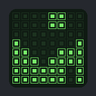
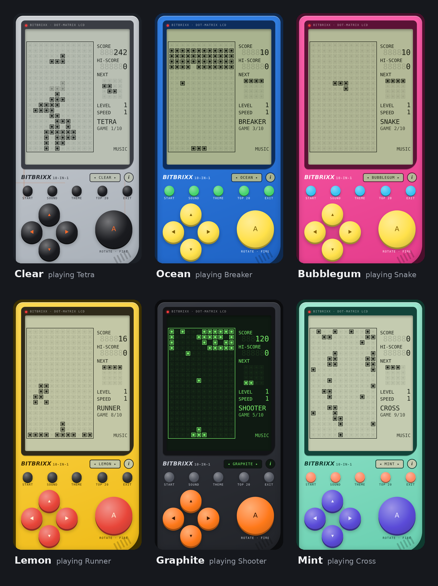
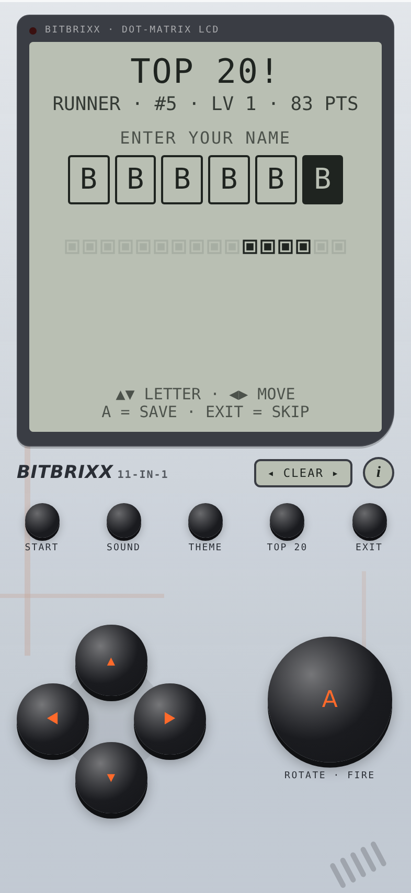
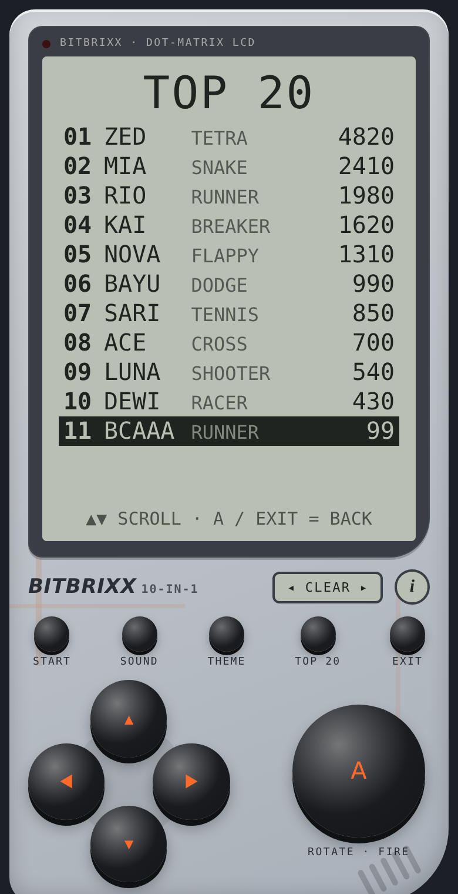
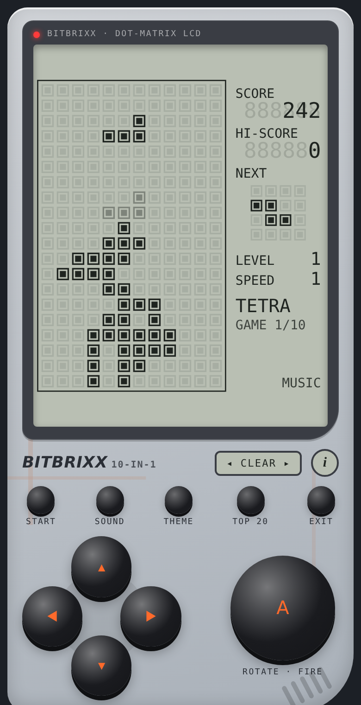
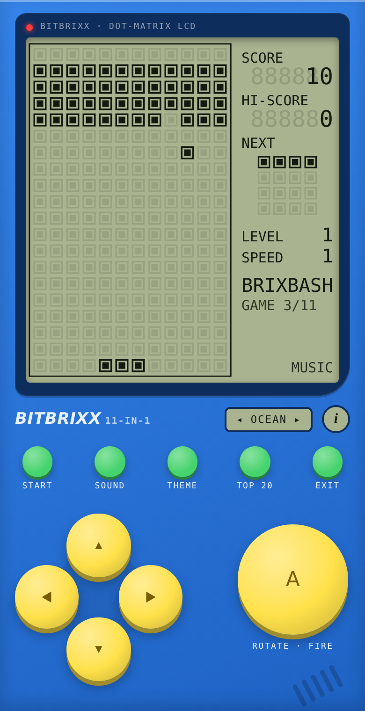
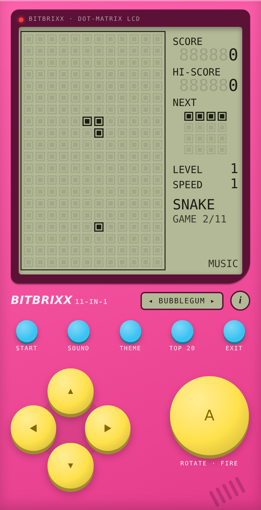
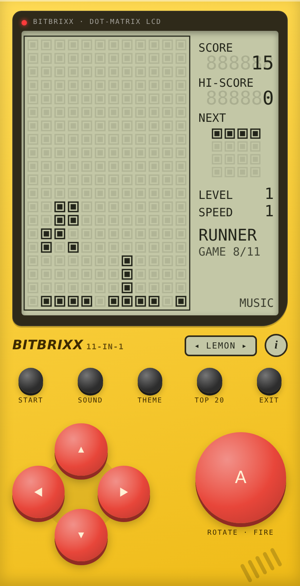
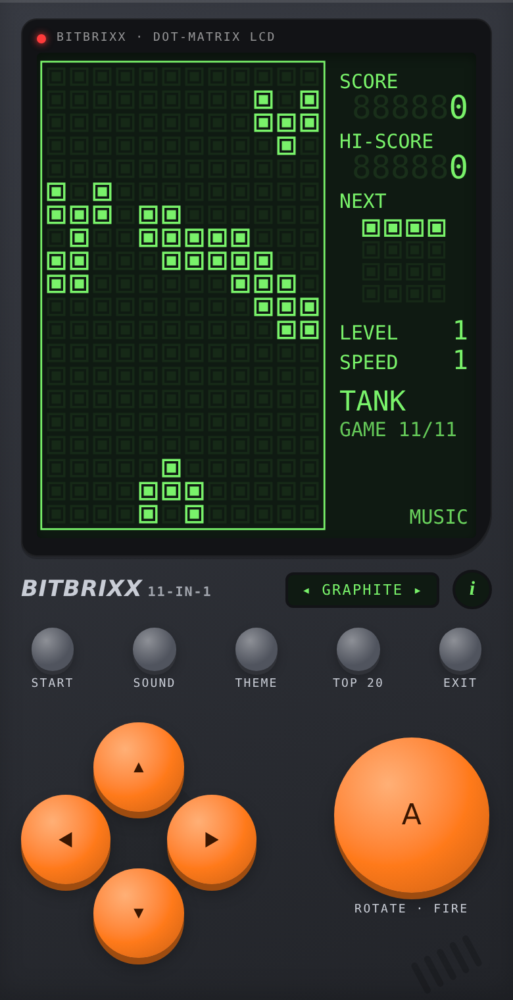
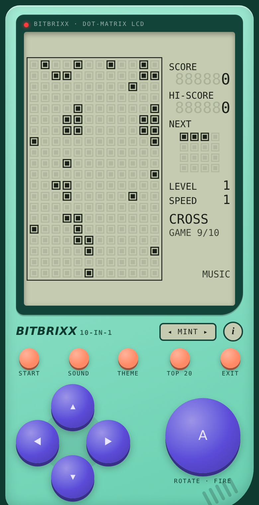

  

<h1 align="center">BITBRIXX</h1>

  <b>A pocket brick-game console with 10 games, 6 shell themes, an 8-bit soundtrack and a worldwide Top 20, playable right in your phone's browser.</b> 
  No download, no account, no ads. It works offline once you've opened it.

  <a href="https://inlndr.github.io/bitbrixx/"><b>▶ Play now</b></a> ·
  <a href="docs/MANUAL.md">How to play</a> ·
  <a href="#install-it-like-an-app">Install on your phone</a> ·
  <a href="#top-20-leaderboard">Top 20</a>

  

---

## What's inside

Bitbrixx recreates the feel of the classic handheld brick games: a dot-matrix LCD with a score panel, chunky buttons and blocky sound effects. It's built to be played with your thumbs on a phone.

- **10 games in one console.** Switch between them from the menu.
- **A Top 20 leaderboard shared by everyone who plays.** No login: you just enter a name of up to 5 letters, like an arcade machine.
- **6 shell themes.** Clear, Ocean, Bubblegum, Lemon, Graphite (with a green backlight) and Mint.
- **An original 8-bit soundtrack.** It has a calm menu tune, a game tune that speeds up as you level up, and a mocking song when you lose.
- **A separate high score for each game,** saved on your device.
- **Speed and starting level** settings from 1 to 9, like the original consoles.
- **Offline play** after you install it to your Home Screen.

## The games

| # | Game | What you do |
|---|------|-------------|
| 1 | **Tetra** | Stack falling blocks and clear full lines. Shows a ghost preview of where the piece will land. |
| 2 | **Snake** | Eat the blinking dot, grow longer, and don't bite yourself. |
| 3 | **Breaker** | Bounce the ball and smash the brick wall. |
| 4 | **Racer** | Switch lanes to dodge oncoming cars. Hold **A** to go faster. |
| 5 | **Shooter** | Shoot down the brick rows before they reach you. |
| 6 | **Tennis** | Rally the ball past the computer's paddle. |
| 7 | **Flappy** | Tap to flap through the gaps in the pipes. |
| 8 | **Runner** | An endless runner: hop or double-jump over cacti, and duck under birds. |
| 9 | **Cross** | Move the frog across 14 lanes of traffic. |
| 10 | **Dodge** | Dodge the falling rocks for as long as you can. |

The full rules and controls for every game are in the **[Play Manual](docs/MANUAL.md)**.

## Top 20 leaderboard

| Got a top score? | Everyone's best |
|:---:|:---:|
|  |  |

- There's **one board for all 10 games**. Each entry shows the player's name, the game and the score.
- **To get on the board:** you need at least **500 points**. Once the board has 20 names, you have to **beat the lowest score on it**, so the bar keeps rising as people play.
- When a game ends with a qualifying score, you get to enter a name of up to **5 letters**. Use ▲▼ to pick each letter, ◀▶ to move, and **A** to save.
- Tap **TOP 20** on the menu to see the board at any time.
- If you play offline, your score is saved and uploads automatically the next time you're online.

*The leaderboard screenshot shows example names.*

## Controls at a glance

| Button | On the menu | In a game |
|--------|-------------|-----------|
| ◀ ▶ | Choose a game | Move |
| ▲ | Change speed (1–9) | Jump, flap, fire, or hard-drop (depends on the game) |
| ▼ | Change starting level (1–9) | Move down, soft-drop or duck |
| **A** | Start | Rotate, fire, jump or launch |
| START | Start | Pause or resume |
| SOUND | Switch between Music, SFX and Mute | Same |
| THEME | Change the shell colour | Same |
| TOP 20 | Show the leaderboard | – |
| EXIT | – | Back to the menu |
| **i** | About Bitbrixx | – |

You can also play on a computer keyboard: arrow keys, **Space** or **X** for A, **Enter** for START, **Esc** for EXIT, **S** for SOUND, **T** for THEME, **R** for TOP 20 and **I** for About.

## Themes

| Clear | Ocean | Bubblegum |
|:---:|:---:|:---:|
|  |  |  |
| **Lemon** | **Graphite** | **Mint** |
|  |  |  |

Tap **THEME**, or tap the little theme window next to the logo, to switch themes. The game remembers your choice.

## Install it like an app

### iPhone / iPad
1. Open the **Play now** link in **Safari**.
2. Tap the **Share** button, then **Add to Home Screen**.
3. Open Bitbrixx from your Home Screen. It runs full screen, and after the first launch it works offline.

### Android
1. Open the link in **Chrome**.
2. Tap **⋮**, then **Add to Home screen** or **Install app**.

> 🔊 **No sound on iPhone?** Tap any button once, because phones only allow sound after a touch. Then turn up the media volume. The bottom-right corner of the screen shows **MUSIC**, **SFX** or **MUTE**.

## Credits

Created by **inlndr @ 2026**.

The music and game graphics are original and not copied from any existing game.

## License

**© 2026 inlndr. All rights reserved.**

You're welcome to **play** Bitbrixx and **share the link** with friends. 🎮

You may **not** copy, modify, reuse or re-upload the code, graphics, music or any other part of this project, in whole or in part, without written permission. See [LICENSE](LICENSE) for the full terms.
