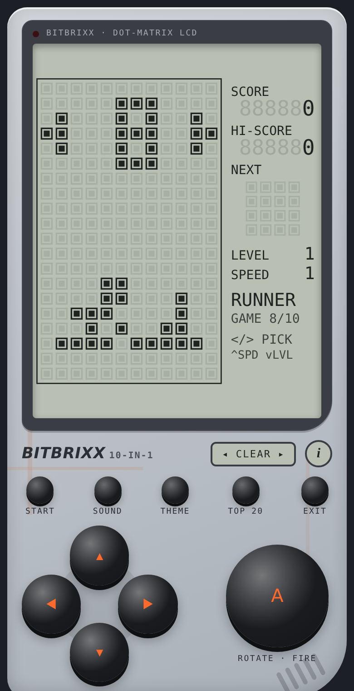

# Bitbrixx · Play Manual

← [Back to README](../README.md)

**Contents**
- [The console](#the-console)
- [The screen](#the-screen)
- [Starting a game](#starting-a-game)
- [Lives, levels and scores](#lives-levels-and-scores)
- [Top 20 leaderboard](#top-20-leaderboard)
- [About screen](#about-screen)
- Games: [Tetra](#1--tetra) · [Snake](#2--snake) · [Breaker](#3--breaker) · [Racer](#4--racer) · [Shooter](#5--shooter) · [Tennis](#6--tennis) · [Flappy](#7--flappy) · [Runner](#8--runner) · [Cross](#9--cross) · [Dodge](#10--dodge)
- [Troubleshooting](#troubleshooting)

 

---

## The console

| Button | What it does |
|--------|--------------|
| **◀ ▲ ▶ ▼** (direction pad) | Moves, and changes settings on the menu. Hold ◀ ▶ ▼ to repeat. |
| **A** (big button) | The main action: rotate, fire, jump, flap or launch |
| **START** | Starts a game, or pauses and resumes during play |
| **SOUND** | Switches between **MUSIC** (music and effects), **SFX** (effects only) and **MUTE** |
| **THEME** | Changes the shell colour |
| **TOP 20** | Shows the leaderboard (from the menu) |
| **i** (next to the theme window) | Shows the About screen (from the menu) |
| **EXIT** | Ends the game and goes back to the menu |

**Keyboard:** arrow keys · **Space** or **X** = A · **Enter** = START · **Esc** = EXIT · **S** = SOUND · **T** = THEME · **R** = TOP 20 · **I** = About

## The screen

The left side is the **play field**, 12 bricks wide and 20 bricks tall. The right side is the **info panel**:

- **SCORE** and **HI-SCORE**: your current score and your best score for this game.
- **NEXT**: a small 4×4 box. In Tetra it shows the next piece. In most other games, the **top row shows your lives**, one dot per life. In Shooter it shows a timer bar.
- **LEVEL** and **SPEED**: your current level and the speed setting.
- **Game name** and number, such as `TETRA · GAME 1/10`.
- **Sound status** in the bottom-right corner. If it blinks **TAP**, sound hasn't started yet, so tap any button.

## Starting a game

1. On the menu, press **◀ ▶** to choose a game. The big number and the picture show which one is selected.
2. Press **▲** to set the **SPEED** (1–9). A higher speed makes everything faster.
3. Press **▼** to set the starting **LEVEL** (1–9). A higher level starts you deeper into the game.
4. Press **A** or **START** to play.

The game pauses by itself if you switch to another app. Press **START** or **A** to continue.

## Lives, levels and scores

- Most games give you **4 lives**. When you lose one, your piece blinks and you continue from a safe spot. Tetra and Shooter have no lives: the game ends when the bricks fill up.
- Points are **multiplied by your level**, so the same move is worth more later on.
- Every game gets **faster or harder** as you level up, and the music speeds up with it.
- When the game ends, the screen fills up, a mocking 8-bit song plays, and you get a **HA HA HA!** If your score made the Top 20, you can enter your name next. Otherwise you're back on the menu.
- High scores are saved **on your device** for each game. If you clear your browser data, they're erased.

## Top 20 leaderboard

There's **one shared board for all 10 games**, and everyone who plays the game sees it.

**Getting on the board**
1. Finish a game with at least **500 points**. While the board has fewer than 20 names, that's enough. Once it's full, your score must also **beat the lowest score on the board** (the 20th place), which pushes that score off.
2. After the game-over song, the **TOP 20!** screen shows your rank.
3. Enter a name of up to **5 letters or numbers**: ▲▼ changes the letter, ◀▶ moves between slots, and **A** saves. **EXIT** skips it.
4. The board opens with your entry highlighted. The game remembers your name for next time.

**Seeing the board:** press **TOP 20** on the menu. Scroll with ▲▼, and press **A** or **EXIT** to go back.

**Playing offline:** your score is saved on your phone and uploads by itself the next time you're online. The board shows "waiting to upload" until it's sent.

Rude names aren't accepted, so pick something friendly.

## About screen

Press the round **i** button next to the theme window to see the game version and who made it.

---

## 1 · Tetra
*Stack the falling blocks and clear lines.*

| Control | Action |
|---|---|
| ◀ ▶ | Move the piece |
| **A** | Rotate |
| ▼ | Soft drop (fall faster) |
| ▲ | Hard drop (drop instantly) |

- Fill a whole row from left to right to clear it.
- **Scoring:** 1 line = 100 · 2 lines = 300 · 3 lines = 500 · 4 lines = 800, all × level. You also get +1 per row for a soft drop and +2 per row for a hard drop.
- **Level up** every 10 lines.
- The faint **ghost piece** shows where your piece will land.
- Pieces come in shuffled sets of 7, so you'll never wait too long for the long bar.
- **Game over** when a new piece has no room at the top.

## 2 · Snake
*Eat, grow, and don't crash.*

| Control | Action |
|---|---|
| ◀ ▲ ▶ ▼ | Turn |
| **A** | Step forward right away (a quick dash) |

- Eat the **blinking dot** for 10 × level points, and you grow one brick longer.
- **Level up** every 8 dots.
- Hitting a wall or your own body costs a life.
- **Tip:** you can press up to 3 turns ahead, which helps with tight U-turns.

## 3 · Breaker
*Smash the brick wall.*

| Control | Action |
|---|---|
| ◀ ▶ | Move the paddle |
| **A** or ▲ | Launch the ball |

- Each brick is worth 10 × level points. Clearing the whole wall gives a **+100 × level bonus** and takes you to the next level, which has more rows and new patterns.
- Where the ball hits the paddle matters: the **edges send it sideways**, and the **middle keeps its direction**.
- Missing the ball costs a life.

## 4 · Racer
*Dodge the traffic.*

| Control | Action |
|---|---|
| ◀ ▶ | Switch lanes |
| hold **A** or ▲ | Turbo (move faster) |

- Each car you pass is worth 10 × level points.
- **Level up** every 15 cars.
- Crashing into a car costs a life.

## 5 · Shooter
*Shoot the bricks before they reach you.*

| Control | Action |
|---|---|
| ◀ ▶ | Move the gun. It can reach the edge columns. |
| **A** or ▲ | Fire. Hold to keep firing. |

- Each brick is worth 10 × level points. You can have up to 4 bullets on screen at once.
- Every few seconds a **new row pushes the wall down**. The bar in the NEXT box shows how long until the next row.
- **Level up** every 40 bricks, and the rows come faster.
- **Game over** when the wall reaches the bottom three rows.

## 6 · Tennis
*Beat the computer.*

| Control | Action |
|---|---|
| ◀ ▶ | Move your paddle (the bottom one) |
| **A** or ▲ | Serve |

- Get the ball past the computer's paddle for 50 × level points.
- **Level up** every 5 points, and the computer gets quicker and smarter.
- Missing the ball costs a life.
- **Tip:** hit the ball with the edge of your paddle to send it at an angle the computer can't reach.

## 7 · Flappy
*Flap through the pipes.*

| Control | Action |
|---|---|
| **A** or ▲ | Flap |

- The bird hovers until your first flap, so take your time.
- Each pipe you pass is worth 10 × level points.
- **Level up** every 10 pipes, and the gaps get smaller.
- Touching a pipe or the floor costs a life. The ceiling is safe.
- **Tip:** short, steady taps work better than big flaps.

## 8 · Runner
*Run as far as you can.*

| Control | Action |
|---|---|
| **A** or ▲ | Jump: a short hop. The run starts with your first jump. |
| **A** or ▲ again, in the air | Double jump: a second hop that takes you much higher |
| hold ▼ | Duck. While you're in the air, holding ▼ makes you fall faster. |

- You score points for **every step you run** (× level).
- **Short cacti:** a single hop clears them.
- **Tall or wide cacti:** you need a **double jump**. Tap once, then tap again near the top of your hop.
- From level 2, **birds** fly in at head height. **Duck** under them, or double-jump over them.
- **Level up** every 250 steps. The game speeds up and obstacles come more often.
- Hitting an obstacle costs a life, and the track clears so you can start running again.
- **Tip:** don't double-jump over everything. A double jump keeps you in the air longer, so you may come down right on the next cactus.

## 9 · Cross
*Get the frog across the road.*

| Control | Action |
|---|---|
| ◀ ▲ ▶ ▼ | Hop one square |

- Reach the **top row** for 100 × level points, and the frog starts again at the bottom.
- The empty rows between the traffic are **safe spots** to wait in.
- **Level up** every 3 crossings, and traffic gets faster and busier.
- Getting hit by a car costs a life.

## 10 · Dodge
*Survive the rock rain.*

| Control | Action |
|---|---|
| ◀ ▶ | Move your ship |

- Each rock that falls past you is worth 5 × level points.
- **Level up** every 40 rocks, and more rocks fall faster.
- Getting hit costs a life.

---

## Troubleshooting

| Problem | Fix |
|---|---|
| **No sound** | Tap any button once, because phones only allow sound after a touch. Turn up the media volume. Press SOUND until the screen shows **MUSIC**. |
| **TOP 20 says the leaderboard is off** | The leaderboard only works on the GitHub version after it has been set up. See the README. |
| **TOP 20 says it can't reach the leaderboard** | Check your internet. Your score is kept and uploads later. |
| **No sound on iPhone** | Open the game in Safari or from your Home Screen. Some in-app browsers block sound. |
| **The game is paused** | It pauses when you switch apps. Press START or A. |
| **High scores are gone** | Scores are saved in your browser on this device. Clearing browser data, or opening the game in a different browser, starts them fresh. |
| **The game doesn't open offline** | Open it once while you're online, from the Home Screen icon. After that it works without internet. |

← [Back to README](../README.md)

---

© 2026 inlndr. All rights reserved. See [LICENSE](../LICENSE).
